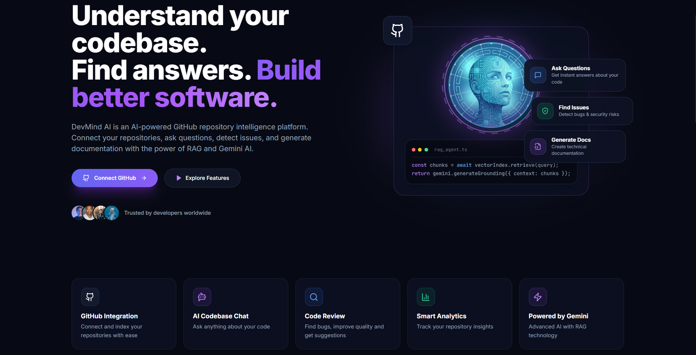
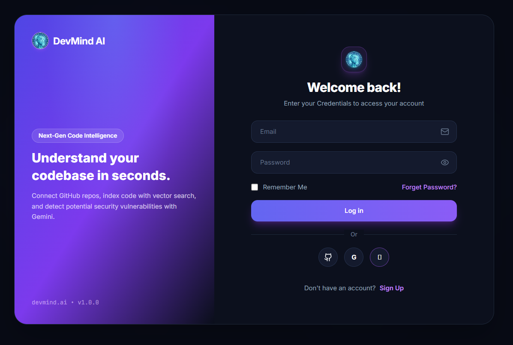
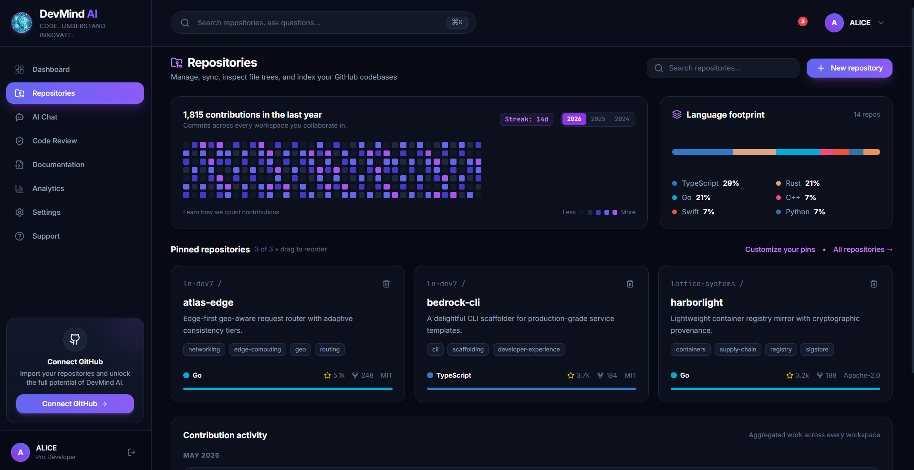
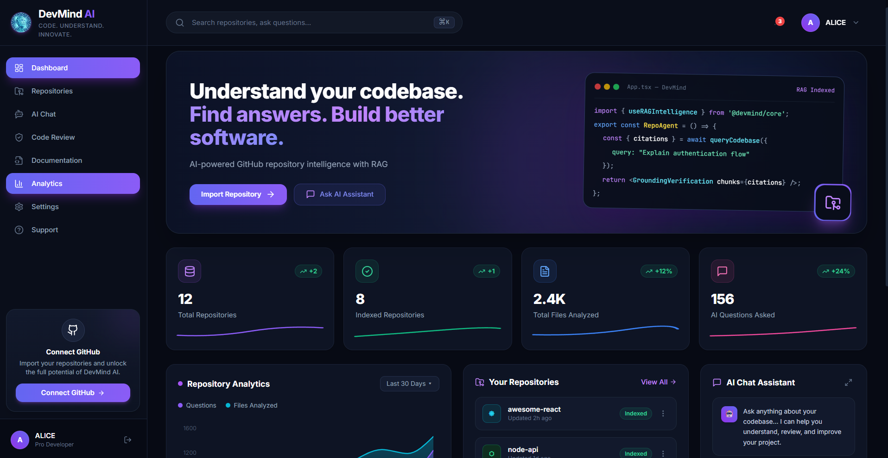
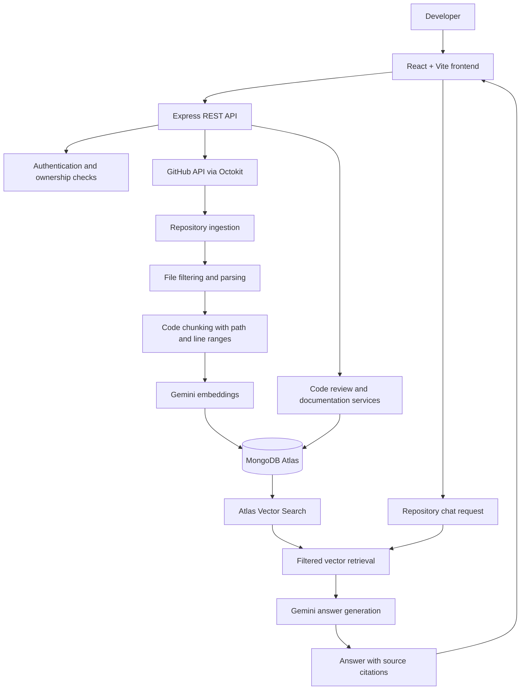

<div align="center">
  
  <h1>DevMind AI</h1>
  <p><strong>Understand your codebase. Find answers. Build better software.</strong></p>
  <p>An AI-powered GitHub repository intelligence platform designed to help developers explore unfamiliar codebases, ask grounded questions, identify code-quality and security concerns, and generate useful documentation.</p>
  <p>
    
    
    
    
    
    <a href="LICENSE"></a>
  </p>
  <p>
    <a href="#-the-problem">The problem</a> ·
    <a href="#-features">Features</a> ·
    <a href="#-screenshots">Screenshots</a> ·
    <a href="#-architecture">Architecture</a> ·
    <a href="#-getting-started">Getting started</a> ·
    <a href="#-license">License</a>
  </p>
</div>

---

> **Project status:** DevMind AI is being developed as an advanced MERN + AI portfolio project. The screenshots below document the current visual direction. They do not, by themselves, verify that GitHub OAuth, indexing, vector retrieval, AI analysis, or deployment are fully implemented. Update the status and setup details in this README as each feature is tested end to end.

## 🧠 The problem

Joining an unfamiliar codebase can mean spending hours locating the right files, tracing how modules connect, understanding conventions, and figuring out where bugs or security risks may exist. Traditional code search helps find text, but it does not always explain how the pieces fit together.

**DevMind AI aims to turn a repository into an explorable knowledge base.** A developer connects a GitHub repository, DevMind indexes supported source files, and an AI assistant answers questions using retrieved code context. Answers should point back to the relevant file and line range so developers can verify them instead of trusting an unsupported response.

## ✨ Features

| Feature | What it is intended to do |
|---|---|
| **GitHub integration** | Authenticate with GitHub and import repositories the user is authorized to access. |
| **Repository intelligence** | Inspect repository metadata, branches, languages, file trees, and indexing status. |
| **Code ingestion** | Filter irrelevant files, fetch source content safely, and track file hashes for incremental indexing. |
| **Semantic code search** | Split source into useful chunks, generate embeddings, and retrieve relevant code with MongoDB Atlas Vector Search. |
| **AI codebase chat** | Ask natural-language questions about a repository and receive answers grounded in retrieved source. |
| **Verifiable citations** | Return source file paths and line ranges alongside answers to make verification practical. |
| **Code review assistance** | Combine deterministic tooling with AI explanations to surface maintainability and potential security issues. |
| **Documentation generation** | Draft repository-specific README and API documentation from indexed project context. |
| **Analytics dashboard** | Present repository, language, indexing, file, and chat activity metrics. |

### A note on AI reliability

The assistant should say when the indexed context is insufficient, cite the source chunks used, and avoid inventing files, functions, or line numbers. AI-generated security observations should be treated as findings to review—not confirmed vulnerabilities—unless a deterministic check or manual verification supports them.

## 🖥️ Screenshots

The following images are included in this repository under `docs/images/` and use relative links, so they will render on GitHub after the folder is committed.

### Landing page


### Sign-in experience



### Repository workspace



### Dashboard and analytics



## 🏗️ Architecture

DevMind AI is planned as a modular MERN application with a retrieval-augmented generation (RAG) pipeline.



### Main components

| Layer | Responsibility | Candidate technologies |
|---|---|---|
| Frontend | Application UI, routing, forms, chat, repository views, analytics | React, Vite, Tailwind CSS, React Router, Zustand, TanStack Query |
| API | Authentication, authorization, validation, repository and AI endpoints | Node.js, Express, Mongoose, Zod |
| GitHub | OAuth flow, repository metadata, branch and file access | GitHub OAuth, Octokit |
| Persistence | Users, repositories, files, chunks, chat sessions, analyses, generated docs | MongoDB Atlas, Mongoose |
| Retrieval | Similarity search scoped to the selected repository | MongoDB Atlas Vector Search |
| AI | Embeddings, grounded responses, review explanations, documentation drafts | Gemini API behind a provider/service abstraction |
| Static analysis | Repeatable lint and security checks | ESLint, Semgrep or other suitable analyzers |

### Repository ingestion pipeline

1. Authenticate the user and confirm access to the selected GitHub repository.
2. Fetch repository metadata, the chosen branch, and its file tree through Octokit.
3. Exclude generated output, dependencies, binaries, lockfiles, build directories, and files that should not be indexed.
4. Fetch supported source files within configured size and count limits.
5. Parse source where possible and split it into meaningful chunks; preserve each chunk's file path and start/end line numbers.
6. Generate embeddings using the selected embedding model.
7. Store file metadata and code chunks in MongoDB; use content hashes to skip unchanged files and support re-indexing.
8. Update indexing status and expose useful progress/error information to the UI.

### RAG question-answering pipeline

1. Verify the signed-in user owns or can access the requested repository.
2. Embed the user's question with the **same embedding model and compatible dimensions** used during indexing.
3. Run Atlas Vector Search with a mandatory `repositoryId` filter so code from another repository cannot leak into the result set.
4. Retrieve a small set of relevant chunks and, where useful, apply keyword search or reranking.
5. Give Gemini the question and retrieved chunks, including file paths and line ranges, as untrusted reference context.
6. Return a grounded explanation with citations, save the conversation, and clearly state when context is insufficient.

> **Important:** Code found in a repository is untrusted input. Do not follow instructions embedded in source files, execute repository code as part of answering a question, or allow retrieved text to override system or application instructions.

## 🗂️ Suggested project structure

The structure below is a recommended starting point. Keep the actual tree in sync with the codebase as it evolves.

```text
devmind-ai/
├── client/
│   ├── public/
│   └── src/
│       ├── components/
│       │   ├── common/
│       │   ├── dashboard/
│       │   ├── repositories/
│       │   ├── chat/
│       │   └── analysis/
│       ├── pages/
│       ├── layouts/
│       ├── routes/
│       ├── hooks/
│       ├── services/
│       ├── store/
│       └── utils/
├── server/
│   └── src/
│       ├── config/
│       ├── controllers/
│       ├── middleware/
│       ├── models/
│       ├── routes/
│       ├── validators/
│       ├── services/
│       │   ├── github/
│       │   ├── ingestion/
│       │   ├── embeddings/
│       │   ├── rag/
│       │   ├── analysis/
│       │   └── documentation/
│       ├── jobs/
│       └── utils/
├── docs/
│   └── images/
├── .gitignore
└── README.md
```

## 🧰 Technology stack

- **Frontend:** React, Vite, Tailwind CSS, shadcn/ui, React Router, Zustand, TanStack Query, Axios, Recharts, Lucide.
- **Backend:** Node.js, Express, JavaScript ES modules, Mongoose, Zod.
- **Database and retrieval:** MongoDB Atlas and Atlas Vector Search.
- **GitHub connectivity:** GitHub OAuth and Octokit.
- **AI:** Gemini API for embeddings and generation, wrapped behind application services so providers can be changed without rewriting the RAG workflow.
- **Quality and security:** ESLint, Semgrep (or equivalent), Helmet, rate limiting, secure cookies, request validation, and automated tests.
- **Optional background processing:** BullMQ and Redis for larger repository indexing jobs. Start with a bounded synchronous flow for small repositories before adding queue infrastructure.
- **Deployment target:** Vercel for the frontend and Render (or a comparable Node hosting service) for the API, with MongoDB Atlas as the managed database.

## 🚀 Getting started

### Prerequisites

- Node.js LTS and npm
- A MongoDB Atlas cluster
- A GitHub OAuth App (for GitHub sign-in and repository access)
- A Gemini API key (for embedding and generation features)

### 1. Clone the repository

```bash
git clone <YOUR_REPOSITORY_URL>
cd devmind-ai
```

### 2. Install dependencies

If the project uses separate client and server package files:

```bash
cd server
npm install

cd ../client
npm install
```

If you configure npm workspaces at the repository root, install from the root instead. Use the scripts defined in your own `package.json` files; the commands below are conventional examples, not a guarantee of the current scripts.

### 3. Configure environment variables

Create `server/.env` and keep it out of version control. Use the variables your implementation actually reads; names below are a suggested convention.

```dotenv
# Server
NODE_ENV=development
PORT=5000
CLIENT_URL=http://localhost:5173

# MongoDB Atlas
MONGODB_URI=mongodb+srv://<username>:<password>@<cluster-url>/<database>

# Application authentication
JWT_SECRET=<generate-a-long-random-secret>
COOKIE_SECRET=<generate-another-long-random-secret>

# GitHub OAuth
GITHUB_CLIENT_ID=<github-oauth-client-id>
GITHUB_CLIENT_SECRET=<github-oauth-client-secret>
GITHUB_CALLBACK_URL=http://localhost:5000/api/auth/github/callback

# Gemini
GEMINI_API_KEY=<gemini-api-key>
GEMINI_MODEL=<configured-generation-model>
GEMINI_EMBEDDING_MODEL=<configured-embedding-model>
EMBEDDING_DIMENSIONS=<embedding-model-dimension>
```

For Vite, any frontend environment variable exposed to browser code must use the `VITE_` prefix. Never put private API keys, JWT secrets, GitHub client secrets, or database credentials in frontend variables.

### 4. Configure GitHub OAuth

In your GitHub OAuth App settings, configure the authorization callback URL to match `GITHUB_CALLBACK_URL`. Request only the minimum scopes needed for the repository access your app supports. Keep the OAuth client secret on the server and protect stored access tokens with encryption at rest.

### 5. Configure MongoDB Atlas Vector Search

Create a Vector Search index for the code-chunk collection. The indexed vector field, vector dimensions, and similarity function must match the selected embedding model. Include repository metadata as filterable fields and always apply the repository ownership and `repositoryId` filters in retrieval queries. Do not copy an example dimension from another model—read it from the model configuration you selected.

### 6. Run the application

Start the API and frontend in separate terminals using the scripts defined by the project:

```bash
# Terminal 1
cd server
npm run dev

# Terminal 2
cd client
npm run dev
```

Open the local Vite URL printed in the frontend terminal (commonly `http://localhost:5173`). Confirm the API health endpoint and database connection before testing authentication or repository indexing.

## 🔌 API surface

The following is a **proposed API contract** for the planned modules. Treat it as a design reference until the corresponding routes are implemented and tested.

| Area | Method | Endpoint | Purpose |
|---|---|---|---|
| Auth | `POST` | `/api/auth/register` | Register an account |
| Auth | `POST` | `/api/auth/login` | Sign in |
| Auth | `POST` | `/api/auth/logout` | Clear the session |
| Auth | `GET` | `/api/auth/me` | Return the current user |
| Auth | `GET` | `/api/auth/github` | Start GitHub OAuth |
| Auth | `GET` | `/api/auth/github/callback` | Handle GitHub OAuth callback |
| Repositories | `GET` | `/api/repositories` | List accessible imported repositories |
| Repositories | `POST` | `/api/repositories/import` | Import a repository |
| Repositories | `POST` | `/api/repositories/:id/index` | Start or retry indexing |
| Repositories | `GET` | `/api/repositories/:id/files` | List indexed files |
| Chat | `POST` | `/api/chat/:repoId` | Ask a repository question |
| Chat | `GET` | `/api/chat/sessions` | List chat sessions |
| Analysis | `POST` | `/api/analysis/:repoId/quality` | Run quality analysis |
| Analysis | `POST` | `/api/analysis/:repoId/security` | Run security analysis |
| Documentation | `POST` | `/api/docs/:repoId/readme` | Generate a README draft |
| Documentation | `POST` | `/api/docs/:repoId/api` | Generate API documentation draft |

## 🧪 Testing and verification

Prioritize tests around data boundaries and the complete user journey—not only isolated UI components.

- **Authentication:** registration, login, invalid credentials, logout, expired sessions, and protected routes.
- **Authorization:** a user cannot view, index, chat with, or delete another user's repository or data.
- **GitHub integration:** OAuth state validation, permission errors, private repository access, rate limits, pagination, and revoked tokens.
- **Ingestion:** file exclusions, large-file limits, unsupported languages, duplicate imports, changed-file re-indexing, and partial failures.
- **Chunking:** each chunk retains the correct repository, file path, and start/end line numbers.
- **Vector retrieval:** embeddings have the configured dimensions and results are filtered to the requested repository.
- **RAG:** answers cite retrieved chunks, unsupported questions are handled honestly, and source citations point to real file ranges.
- **Analysis:** validate structured model output and distinguish deterministic findings from AI suggestions.
- **Security:** rate limits, input validation, CSRF protections where applicable, secure cookie flags, secret redaction, and safe error messages.

### Recommended first end-to-end acceptance test

1. Sign in with GitHub and import a small repository you own.
2. Index a few supported source files and confirm file/chunk records are stored.
3. Confirm an embedding is generated for each chunk and its dimensions match the Vector Search index.
4. Ask a question whose answer is clearly present in one of those files.
5. Verify the response cites the correct path and line range, and that the cited code actually supports the answer.
6. Ask a question unrelated to the repository and confirm the assistant does not fabricate an answer or citation.

**This flow is the project's critical path.** Complete it before investing heavily in optional dashboards, animations, advanced analytics, or queue infrastructure.

## 🔐 Security principles

- Hash passwords with a modern password-hashing algorithm and appropriate work factor.
- Use HTTP-only, `Secure` (in production), appropriately `SameSite` cookies; add CSRF protection appropriate to the authentication design.
- Keep GitHub and Gemini secrets on the server. Encrypt stored OAuth access tokens and never return them to the browser.
- Validate request bodies, query parameters, and route identifiers; enforce repository ownership on every repository-scoped operation.
- Apply rate limits and sensible request, file-size, repository-size, and indexing limits.
- Exclude likely secrets and sensitive files from indexing. Do not log source credentials, tokens, or full secret-bearing environment values.
- Treat repository source and retrieved chunks as untrusted content. Never execute repository code to answer questions.
- Use deterministic scanners for repeatable checks and present AI-only observations as suggestions requiring review.

## 🗺️ Development roadmap

An 18-day implementation sequence keeps the work focused on a demonstrable end-to-end product.

| Phase | Days | Milestone |
|---|---:|---|
| Foundation | 1–3 | Monorepo, API/client shell, MongoDB connection, authentication, dashboard shell |
| GitHub integration | 4–6 | OAuth, repository import, metadata and file-tree retrieval |
| Ingestion and embeddings | 7–9 | File filtering, parsing, chunking, line metadata, embeddings, persistence |
| RAG chat | 10–12 | Repository-scoped vector retrieval, Gemini responses, verifiable citations, chat history |
| Analysis and docs | 13–15 | Static-analysis integration, AI explanations, README/API documentation drafts |
| Finish and release | 16–18 | Analytics from real data, tests, security hardening, deployment, project documentation and demo |

## 🤝 Contributing

Contributions and improvement suggestions are welcome. For a change:

1. Open an issue describing the bug, improvement, or feature.
2. Create a focused branch from the main development branch.
3. Keep changes scoped and add tests for new behavior.
4. Run the relevant lint, test, and build scripts before opening a pull request.
5. Document new environment variables, API contracts, and setup steps.

## 📄 License

DevMind AI is released under the **MIT License**. See the [`LICENSE`](LICENSE) file for the complete license text.

Before publishing, replace the `[Your Name]` placeholder in `LICENSE` with the copyright holder’s legal name or organization.

## 👨‍💻 Author


<div align="center">
  <strong>DevMind AI</strong><br />
  <sub>Make every codebase easier to understand.</sub><br />
  <sub>Released under the MIT License.</sub>
</div>
